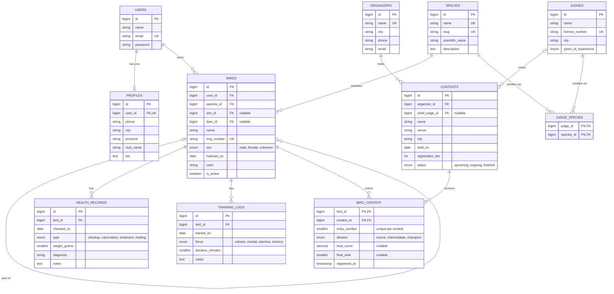

# Database Design: Entity Relationship Diagram

This document describes the database schema of **Gantangan**, a registry for songbird contests, and every Eloquent relationship used in the project. The name comes from the *gantangan*, the stand on which a bird is hung while it is judged.

## 1. Entity Relationship Diagram

## 2. Relationship Summary

| Type                          | Relationship                                                                    | Eloquent                              |
| ----------------------------- | ------------------------------------------------------------------------------- | ------------------------------------- |
| One-to-One                    | `User` ↔ `Profile`                                                              | `hasOne` / `belongsTo`                |
| One-to-Many                   | `User` → `Bird`                                                                 | `hasMany` / `belongsTo`               |
| One-to-Many                   | `Species` → `Bird`                                                              | `hasMany` / `belongsTo`               |
| One-to-Many                   | `Bird` → `HealthRecord`                                                         | `hasMany` / `belongsTo`               |
| One-to-Many                   | `Bird` → `TrainingLog`                                                          | `hasMany` / `belongsTo`               |
| One-to-Many                   | `Organizer` → `Contest`                                                         | `hasMany` / `belongsTo`               |
| One-to-Many                   | `Judge` → `Contest` (chief judge, `chief_judge_id`)                             | `hasMany` / `belongsTo`               |
| Self-referencing One-to-Many  | `Bird` → `Bird` (father, `sire_id`)                                             | `belongsTo` / `hasMany`               |
| Self-referencing One-to-Many  | `Bird` → `Bird` (mother, `dam_id`)                                              | `belongsTo` / `hasMany`               |
| Many-to-Many                  | `Judge` ↔ `Species` (pivot `judge_species`)                                     | `belongsToMany`                       |
| Many-to-Many + pivot data     | `Bird` ↔ `Contest` (pivot `bird_contest`: entry number, division, score, rank)  | `belongsToMany` + `using` + `withPivot` |
| Has-Many-Through              | `User` → `HealthRecord` through `Bird`                                          | `hasManyThrough`                      |
| Has-Many-Through              | `User` → `TrainingLog` through `Bird`                                           | `hasManyThrough`                      |
| Has-Many-Through              | `Species` → `HealthRecord` through `Bird`                                       | `hasManyThrough`                      |

## 3. Tables

| Table            | Purpose                                                                  |
| ---------------- | ------------------------------------------------------------------------ |
| `users`          | Application accounts. A user is a bird owner. Provided by Laravel.       |
| `profiles`       | Contact details and club of an owner (one per user).                     |
| `species`        | Bird species that are entered in contests (seeded).                      |
| `birds`          | Individual birds, identified by a unique ring number.                    |
| `health_records` | Check-ups, vaccinations, treatments and molting notes for a bird.        |
| `training_logs`  | Training sessions of a bird, by focus and duration.                      |
| `organizers`     | Clubs and committees that hold contests.                                 |
| `judges`         | Licensed judges.                                                         |
| `contests`       | A contest held on a date, at a venue, by an organizer.                   |
| `judge_species`  | Pivot: which species a judge is certified to score.                      |
| `bird_contest`   | Pivot: a bird entered in a contest, with its entry number, score, rank.  |

## 4. Species (seeded)

The `species` table is populated by `SpeciesSeeder` with eight species commonly entered in contests:

| Name         | Slug          | Scientific name          |
| ------------ | ------------- | ------------------------ |
| Murai Batu   | `murai-batu`  | Copsychus malabaricus    |
| Kacer        | `kacer`       | Copsychus saularis       |
| Cucak Hijau  | `cucak-hijau` | Chloropsis sonnerati     |
| Cendet       | `cendet`      | Lanius schach            |
| Lovebird     | `lovebird`    | Agapornis spp.           |
| Kenari       | `kenari`      | Serinus canaria          |
| Branjangan   | `branjangan`  | Mirafra javanica         |
| Pleci        | `pleci`       | Zosterops palpebrosus    |

## 5. Design Notes

- **Unique constraints:** `profiles.user_id`, `species.name`, `species.slug`, `birds.ring_number`, `organizers.name`, `judges.license_number`, and (`bird_contest.contest_id`, `bird_contest.entry_number`) so that an entry number is used once per contest.
- **Composite primary keys:** `judge_species` uses (`judge_id`, `species_id`) and `bird_contest` uses (`bird_id`, `contest_id`). A judge is linked to a species once, and a bird can be entered in a contest only once.
- **Pivot data on `bird_contest`:** the entry number, division, total score, final rank and registration time describe the participation itself, not the bird or the contest alone, so they live on the pivot. The `ContestEntry` pivot model casts these columns and exposes them as `$bird->entry` or `$contest->entry`.
- **Scores and ranks:** `total_score` and `final_rank` are nullable because a contest that has not finished has no results yet.
- **Pedigree:** `birds.sire_id` and `birds.dam_id` point back to `birds` and are nullable, because the parents of a bird are often unknown.
- **Cascade rules:** deleting a user cascades to the profile, birds, health records, training logs and contest entries. Deleting a bird cascades to its records and entries. Deleting a parent bird or a chief judge sets the reference to null. Deleting a species that still has birds, or an organizer that still has contests, is restricted.
- **Currency:** `contests.registration_fee` is stored as a whole number in Indonesian rupiah.
